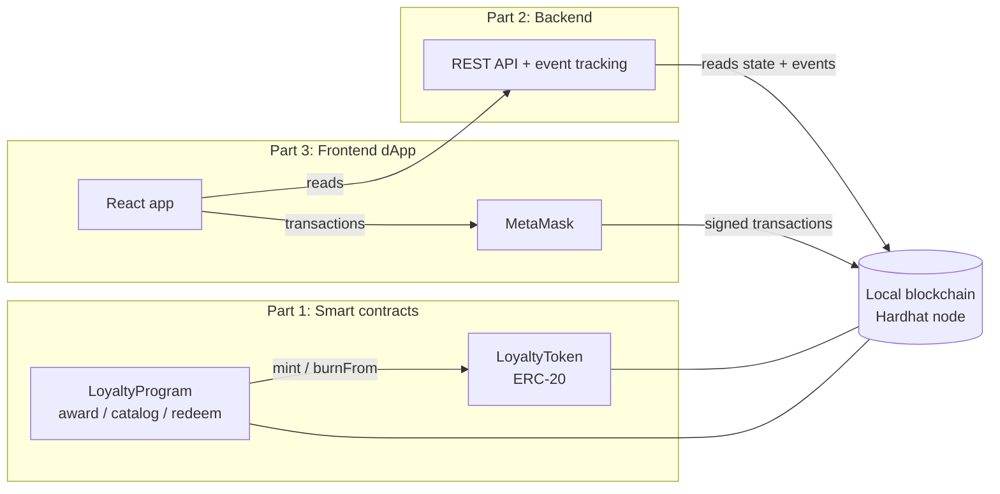

# Blockchain Loyalty Rewards

A customer loyalty program where reward points are **ERC-20 tokens on a blockchain** instead of numbers in a database.

- A merchant **awards** tokens to customers (for example after a purchase).
- Customers **collect** tokens and can **transfer** them to each other.
- Customers **redeem** tokens for rewards from a catalog (the tokens are burned).
- Balances and every transaction can be **tracked on the blockchain**.

## Project structure

The project is split into three parts, one per team member. Each part has its own folder and README.

| Part | Folder | What it does |
|---|---|---|
| 1 | [`1-smart-contracts/`](1-smart-contracts/) | Solidity smart contracts (token + program logic), tests, deployment |
| 2 | [`2-backend/`](2-backend/) | REST API that tracks balances and transactions from contract events, live log, demo data |
| 3 | [`3-frontend/`](3-frontend/) | Web app (dApp) for customers, merchants and the admin, using MetaMask |



**How the parts connect**: Part 1 deploys the contracts and writes their addresses and ABIs to `1-smart-contracts/deployments/localhost.json`. Part 2 reads that file and serves the data from the chain. Part 3 gets the addresses from Part 2, reads through Part 2, and sends transactions through MetaMask straight to the contracts.

## Requirements

- **Node.js 24 or newer** (tested with Node 26.13.0 LTS). The backend runs TypeScript files directly, which needs Node 23.6+. Installed via [nvm](https://github.com/nvm-sh/nvm): `nvm install --lts`
- The **MetaMask** browser extension for Part 3.

Everything runs on a **local** blockchain. No real money, and no internet connection is needed after `npm install`.

## Run everything

Once:
```bash
cd 1-smart-contracts && npm install && cd ..
cd 2-backend && npm install && cd ..
cd 3-frontend && npm install && cd ..
```

Every time (four terminals):
```bash
# Terminal 1: local blockchain (keep running)
cd 1-smart-contracts && npm run node

# Terminal 2: deploy the contracts (after every node start)
cd 1-smart-contracts && npm run deploy:local

# Terminal 3: demo data + backend API on http://localhost:3001/api (keep running)
cd 2-backend && npm run seed && npm start

# Terminal 4: web app on http://localhost:5173 (keep running)
cd 3-frontend && npm run dev
```

Then open `http://localhost:5173` and connect MetaMask (setup: [`3-frontend/README.md`](3-frontend/README.md#metamask-setup-once)).

## Tests

| Part | Command | What |
|---|---|---|
| 1 | `npm test` / `npm run coverage` | 29 contract tests, 100% coverage |
| 2 | `npm test` | Unit tests of the history logic |
| 3 | `npm run build` | Type-check + production build |

⚠️ The local test accounts printed by `npm run node` have **publicly known private keys**. Use them only on the local network.
